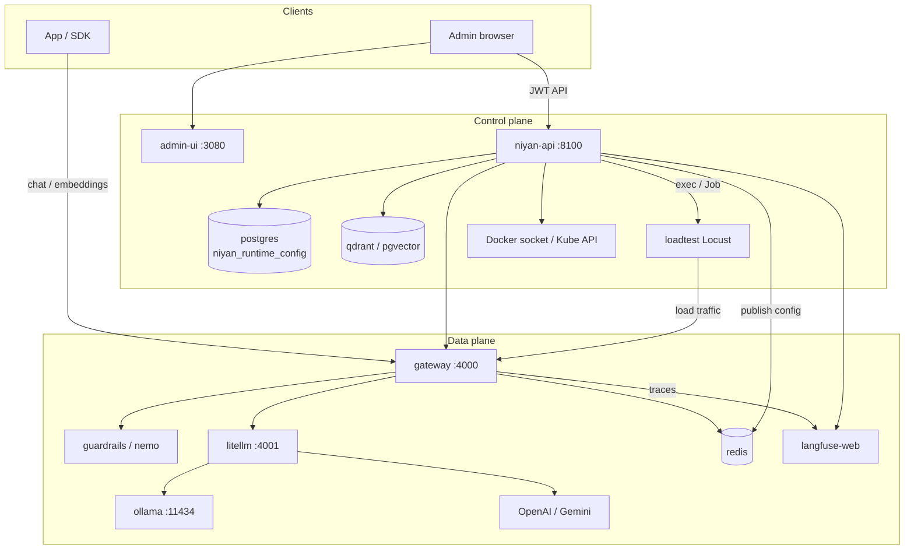
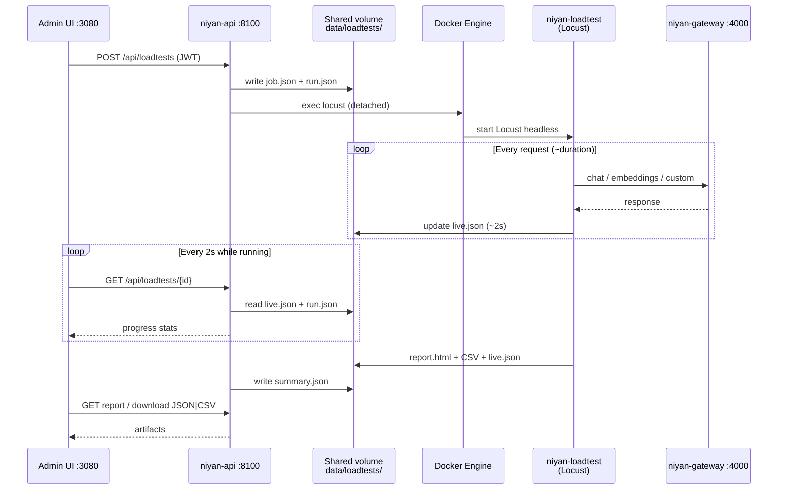
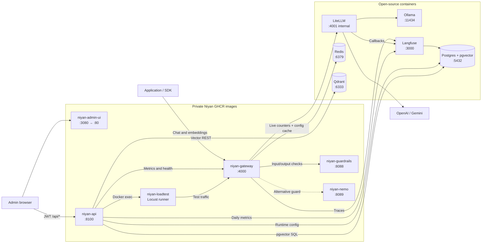

# Niyan architecture & routing

This document explains how Niyan microservices are routed together: chat, embeddings, vector store/retrieve, dashboard, Langfuse, load testing, and how private GHCR images work with open-source containers.

---

## Mental model: two planes

| Plane | Who talks to whom | Purpose |
|--------|-------------------|---------|
| **Data plane** | Clients → **gateway :4000** → LiteLLM → models | Chat / embeddings |
| **Control plane** | Browser → **admin-ui :3080** → **niyan-api :8100** | Dashboard, vectors, load tests, config |

LiteLLM (`:4001`) is **internal only** — nothing outside the stack should call it.

---

## Runtime configuration

Admin UI and `niyan-api` persist `NiyanConfig` (models, provider keys, enterprise policy, Langfuse keys, guardrails, embeddings, vector flags) in **Postgres**. Redis is **not** the config database.

| Layer | Role |
|-------|------|
| **Postgres** table `niyan_runtime_config` | Source of truth. `niyan-api` loads and saves here on Compose / VM. |
| **Redis** keys `niyan:config:json` / `niyan:config:version` | Cache published after each save. Gateway reads this for policy and Langfuse keys (no DB connection on the chat path). |
| **`niyan.yaml`** | First-boot seed (Compose volume) and fallback if Postgres is unreachable. |

```text
Admin UI / CLI-via-API
  → niyan-api ConfigStore
      → Postgres  (commit)
      → Redis     (publish cache)
      → niyan.yaml (best-effort projection; skipped on a read-only ConfigMap)

Gateway (each request)
  → Redis cache if present
  → else niyan.yaml
```

Empty database: API imports `niyan.yaml` (or `configs/niyan.example.yaml`) once, then Postgres wins. Hand-editing the file after seed does not override the row; delete `niyan_runtime_config` and restart `niyan-api` to re-seed.

**LiteLLM model routes** are still generated config + a `litellm` restart. Redis/Postgres hot-reload covers policy and Langfuse keys, not `/v1/models` route tables.

Postgres is **always on** in Compose (not only the `obs` profile). Same instance can also host Langfuse and `niyan_vectors` (separate databases/tables).

---

## End-to-end routing diagram



---

## Chat completion path

```text
Client (Bearer sk-niyan-*)
  → gateway:4000  POST /v1/chat/completions
      → enterprise policy (Postgres config; gateway reads Redis cache, file fallback)
      → guardrails  POST /check  (input)
      → litellm:4001  POST /v1/chat/completions
          → ollama:11434  OR  OpenAI  OR  Gemini
      ← response
      → guardrails  POST /check  (output)
      → Langfuse ingest + Redis metrics
  ← OpenAI-shaped JSON + niyan metadata
```

**Steps**

1. Client hits the gateway with a Niyan API key (not the OpenAI/Gemini key).
2. If `model` is a domain like `finance` / `research` / `legal`, policy picks local vs cloud model from runtime config (gateway: Redis, then `niyan.yaml`).
3. Input text goes through the active guardrail sidecar (`guardrails:8088` or `nemo:8089`).
4. Gateway calls LiteLLM with the **LiteLLM master key**; LiteLLM routes by prefix (`ollama/…`, `openai/…`, `gemini/…`).
5. Output is checked again; then gateway writes a Langfuse trace and Redis counters, and returns the reply.

---

## Embedding request path

```text
Client → gateway:4000 /v1/embeddings → litellm:4001 → usually Ollama (nomic-embed-text)
```

- No enterprise policy.
- No guardrails.
- Metrics go to Redis.
- Langfuse may arrive via LiteLLM callbacks (not the gateway’s manual chat ingest).

---

## Vector store & retrieve

**Important:** the application should **not** call Qdrant or Postgres directly. It calls authenticated `niyan-api` vector endpoints. Embedding generation is a **separate** gateway call. There is no single automatic RAG endpoint today.

### Store a document embedding

#### Step 1 — Generate the embedding

```http
POST http://<host>:4000/v1/embeddings
Authorization: Bearer $NIYAN_API_KEY
Content-Type: application/json

{
  "model": "nomic-embed-text",
  "input": "Niyan provides a sovereign AI control plane."
}
```

Routing:

```text
Application
  → niyan-gateway:4000
  → LiteLLM:4001
  → Ollama:11434 / embedding provider
  ← float vector (typically 768 dims for nomic-embed-text)
```

Example response shape:

```json
{
  "data": [
    {
      "embedding": [0.012, -0.047, 0.083]
    }
  ]
}
```

#### Step 2 — Persist via control plane

Authenticate:

```http
POST http://<host>:8100/api/auth/login

{
  "username": "admin",
  "password": "<admin password: niyan secrets show>"
}
```

Create a collection (once):

```http
POST http://<host>:8100/api/vector/collections
Authorization: Bearer <admin-jwt>

{
  "name": "documents",
  "size": 768
}
```

Upsert points:

```http
POST http://<host>:8100/api/vector/upsert
Authorization: Bearer <admin-jwt>

{
  "collection": "documents",
  "points": [
    {
      "id": "document-001",
      "vector": [0.012, -0.047, 0.083],
      "payload": {
        "title": "Niyan overview",
        "text": "Niyan provides a sovereign AI control plane.",
        "source": "product-documentation"
      }
    }
  ]
}
```

Routing:

```text
Application
  → niyan-api:8100
      → VECTOR_PROVIDER=qdrant
          → qdrant:6333 REST API
      OR
      → VECTOR_PROVIDER=pgvector
          → postgres:5432 SQL
```

Qdrant port `6333` may be published for debugging, but direct access bypasses Niyan auth and provider abstraction.

### Retrieve similar documents

#### Step 1 — Embed the query

```http
POST http://<host>:4000/v1/embeddings
Authorization: Bearer $NIYAN_API_KEY

{
  "model": "nomic-embed-text",
  "input": "How does Niyan govern AI models?"
}
```

Use the **same embedding model** (and dimensions) as stored documents.

#### Step 2 — Search

```http
POST http://<host>:8100/api/vector/search
Authorization: Bearer <admin-jwt>

{
  "collection": "documents",
  "vector": [0.031, -0.052, 0.091],
  "limit": 5
}
```

Example response:

```json
{
  "hits": [
    {
      "id": "document-001",
      "score": 0.91,
      "payload": {
        "title": "Niyan overview",
        "text": "Niyan provides a sovereign AI control plane."
      }
    }
  ]
}
```

#### Step 3 — Use hits in chat (app-orchestrated RAG)

```text
Vector search results
  → select relevant payload text
  → add to chat context
  → POST gateway:4000/v1/chat/completions
```

Full orchestration today:

```text
embed query → vector search → build context → chat
```

**Note:** the Vectors admin page configures the provider and lists collections; it does not yet provide document upload, upsert, or search UI.

---

## Dashboard data sources

Browser loads UI on `:3080` and calls `/api` on the same origin; admin-ui nginx proxies `/api/` to `niyan-api:8100`. The API base comes from `config.js` (`apiBaseUrl: ""`; Helm mounts its own), not a build arg.

`GET /api/dashboard` aggregates:

| Need | Source |
|------|--------|
| Service health | Docker socket via niyan-api |
| Historical traffic/cost | Langfuse `GET /api/public/metrics/daily` |
| Live req/latency/blocks | Gateway `GET /metrics` → Redis |
| Models | Postgres runtime config + Ollama tags |
| Vectors | Qdrant / pgvector health |
| Hardware | `psutil` + `nvidia-smi` (every ~3s) |

---

## Langfuse

- **Write:** gateway POSTs chat traces to `LANGFUSE_HOST/api/public/ingestion` (Basic auth with public/secret keys). LiteLLM also has Langfuse callbacks → possible dual instrumentation.
- **Read:** niyan-api pulls daily metrics for charts.
- **UI:** humans use `:3100`; containers use `http://langfuse-web:3000`.
- Backed by Postgres (Langfuse DB). The same Postgres instance also stores Niyan runtime config (`niyan_runtime_config`) and, when enabled, a separate pgvector DB (`niyan_vectors`).

---

## Load testing end-to-end

Load testing is an **admin-orchestrated Locust run** against the real data plane. The Admin UI never talks to Locust directly — it goes through `niyan-api`, which starts Locust inside the idle `niyan-loadtest` container via the Docker socket.

### Sequence



### 1. Admin portal — configure & start

On **Load Testing**, you pick:

| Field | Meaning |
|--------|---------|
| Target | `gateway_chat`, `gateway_embeddings`, `gateway_domain`, or `custom` |
| Model / domain / prompt | What Locust sends |
| Users / spawn / duration | Locust `-u`, `-r`, `-t` (caps: 50 users, 5–600s) |
| Bearer token | Usually your gateway key (`niyan gateway keys --plain`) |

**Start** calls:

```http
POST http://localhost:8100/api/loadtests
Authorization: Bearer <admin-jwt>
```

Only **one** run can be active (`409` if another is running).

### 2. `niyan-api` — create job & start Locust

`loadtest_runner.create_and_start`:

1. Allocates a run id, e.g. `20260814T183012-a1b2c3d4`
2. Writes under shared volume `data/loadtests/<run_id>/`:
   - `job.json` — target, model, auth, users, host (`http://gateway:4000`)
   - `run.json` — status `queued` → `running`
3. Via Docker socket, finds the `loadtest` container and **`exec`**s:

```bash
locust -f /app/locustfile.py --headless \
  -u <users> -r <spawn> -t <duration>s \
  --host http://gateway:4000 \
  --html /data/loadtests/<id>/report.html \
  --csv /data/loadtests/<id>/run
```

With env:

- `LOADTEST_JOB_PATH=/data/loadtests/<id>/job.json`
- `LOADTEST_OUT_DIR=/data/loadtests/<id>`

That volume is mounted in **both** `niyan-api` and `niyan-loadtest`, so they share files.

A background watcher thread polls until Locust exits, then finalizes `summary.json`.

### 3. Locust — generate real traffic

`niyan-loadtest` sits idle (`sleep infinity`) until exec’d. Locust reads `job.json` and hits:

| Target | Request |
|--------|---------|
| `gateway_chat` | `POST /v1/chat/completions` |
| `gateway_embeddings` | `POST /v1/embeddings` |
| `gateway_domain` | Same as chat, but `model` = domain id (`finance`, …) → policy routing |
| `custom` | Your URL/method/body (SSRF checks unless “allow internal”) |

So traffic goes through the **real** path: gateway → guardrails → LiteLLM → models → metrics/Langfuse.

`listener.py` writes **`live.json` every ~2s**: requests, failures, RPS, p50/p95/p99, tokens, elapsed, user count.

When finished, Locust also writes:

- `report.html` — Locust HTML report
- `run_stats.csv` (and related CSV)
- final `live.json`

### 4. Live progress in the Admin UI

While status is `running` / `queued`, the UI polls every **2 seconds**:

```http
GET /api/loadtests/{run_id}
```

API merges `run.json` + `live.json` (+ `summary.json` when present) and returns progress. The **Live progress** panel shows requests, RPS, fail %, latency percentiles, tokens, elapsed.

**Stop** → `POST /api/loadtests/{id}/stop` → API `pkill`s Locust in the container → status `stopped` → summary written.

### 5. Showing results

When the run finishes (`finished` / `stopped` / `failed`):

| UI action | API | File |
|-----------|-----|------|
| Live / final stats cards | `GET /api/loadtests/{id}` | `live.json` → then `summary.json` |
| **View report** | `GET /api/loadtests/{id}/report` | `report.html` (opens in browser) |
| **Download JSON** | `GET .../download?format=json` | `summary.json` |
| **Download CSV** | `GET .../download?format=csv` | `run_stats.csv` |
| **History** table | `GET /api/loadtests` | all `data/loadtests/*/run.json` |

History rows show status, request count, p95, and the same View / JSON / CSV buttons.

### Shared artifacts on disk

```text
data/loadtests/<run_id>/
  job.json       # what Locust should hit
  run.json       # status lifecycle
  live.json      # live + near-final metrics
  summary.json   # finalized metrics for UI/download
  report.html    # Locust HTML report
  run_stats.csv  # Locust CSV
```

### Status lifecycle

```text
queued → running → finished
                 → stopped   (user Stop)
                 → failed    (Locust never produced metrics)
```

### Practical notes

- Load tests use the **gateway path**, so they can incur cloud cost if the model/domain maps to OpenAI/Gemini.
- Custom URLs must use Docker DNS from Locust (e.g. `http://gateway:4000/...`), not `localhost`.
- Requires Docker socket on `niyan-api` and a running `loadtest` container — Compose/VM path only in this repository.

Load tests are **not** a separate traffic path — they hammer the same gateway path as real clients.

---

## Container topology (GHCR + open source)



All containers join the Docker bridge network named `niyan`. Internal DNS resolves names such as:

```text
http://gateway:4000
http://litellm:4001
http://qdrant:6333
http://langfuse-web:3000
postgres:5432
redis:6379
```

There is no extra service mesh between them.

---

## Private Niyan images (GHCR)

### `niyan-gateway`

Public data-plane entry on `:4000`.

- Niyan API-key validation
- `/v1/chat/completions`, `/v1/embeddings`, `/v1/models`
- Enterprise domain → model policy
- Input/output guardrails (chat)
- Forward to LiteLLM
- Redis metrics + Langfuse chat traces
- Runtime config cache (policy / Langfuse keys): Redis first, `niyan.yaml` fallback

Outgoing:

```text
gateway → guardrails or nemo
gateway → LiteLLM
gateway → Redis
gateway → Langfuse
```

### `niyan-api`

Control-plane API on `:8100`.

- Admin login / JWT
- Dashboard aggregation
- Config, models, providers (Postgres `niyan_runtime_config`)
- Vector collection / upsert / search
- Langfuse metrics read
- Load-test orchestration
- Docker service inventory

Outgoing:

```text
niyan-api → Postgres (runtime config)
niyan-api → Redis (publish config cache)
niyan-api → gateway
niyan-api → Langfuse
niyan-api → Qdrant or pgvector
niyan-api → Ollama
niyan-api → Docker Engine (Compose / VM)
```

### `niyan-admin-ui`

React SPA on `:3080` (Nginx).

```text
Browser → admin-ui:3080       loads HTML/JS
Browser → admin-ui:3080/api   API calls; nginx proxies to niyan-api:8100
```

The API base URL is set only by `config.js` (`apiBaseUrl`).

### `niyan-guardrails`

Internal `:8088`. Profile: `guard-llm`.

```text
gateway → POST guardrails:8088/check   (input and output)
```

### `niyan-nemo`

Alternative policy service on `:8089`. Profile: `guard-nemo`.

```text
gateway → POST nemo-guardrails:8089/check
```

Usually one of `guard-llm` or `guard-nemo` is selected, not both for the same request.

### `niyan-loadtest`

Idle Locust container (no public HTTP port).

```text
Admin UI → niyan-api → Docker socket → exec Locust → traffic to gateway
```

---

## Open-source containers

| Container | Role | Notes |
|-----------|------|--------|
| **LiteLLM** | Model router `:4001` | Not published to host; gateway is the only normal caller |
| **Ollama** | Local models `:11434` | Chat + embeddings; host Ollama possible on macOS/Windows |
| **Redis** | Gateway live counters + config cache `:6379` | Metrics via `gateway /metrics`; config keys `niyan:config:*` |
| **Langfuse** | Traces + daily metrics | Host `:3100` → container `:3000` |
| **Postgres + pgvector** | Runtime config, Langfuse DB, optional vectors | Config table `niyan_runtime_config`; Langfuse DB; vectors `niyan_vectors` |
| **Qdrant** | Vector store `:6333` | Talked to only via `niyan-api` in the intended design |

---

## Compose profiles

| Capability | Profile | Containers added |
|------------|---------|------------------|
| Admin console | `admin` | `niyan-admin-ui` |
| Observability | `obs` | `langfuse-web` (Postgres is already core) |
| Qdrant vectors | `vector-qdrant` | `qdrant` |
| pgvector | `vector-pg` | `postgres` |
| Local container models | `ollama` | `ollama` |
| Standard guardrails | `guard-llm` | `niyan-guardrails` |
| NeMo policy | `guard-nemo` | `niyan-nemo` |

Typical always-on core:

```text
Postgres + Redis + LiteLLM + niyan-gateway + niyan-api + niyan-loadtest
```

---


## Key ports (host defaults)

| Port | Service |
|------|---------|
| `4000` | Gateway (OpenAI API) |
| `8100` | Control API (`niyan-api`) |
| `3080` | Admin UI |
| `3100` | Langfuse UI |
| `11434` | Ollama (if enabled) |
| `6333` | Qdrant (if enabled) |

---

## Source references

- `deploy/docker-compose.yml` / `deploy/docker-compose.release.yml`
- `services/gateway/app.py`
- `api/app/routers/vector.py`
- `api/app/services/vector_store.py`
- `api/app/routers/loadtests.py`
- `api/app/services/loadtest_runner.py`
- `api/app/services/docker_manager.py`
- `services/loadtest/locustfile.py`
- `services/loadtest/listener.py`
- `admin-ui/src/pages/LoadTesting.tsx`
- `api/app/services/config_store.py`
- `services/gateway/runtime_config.py`
- `docs/architecture.md` (high-level companion)
