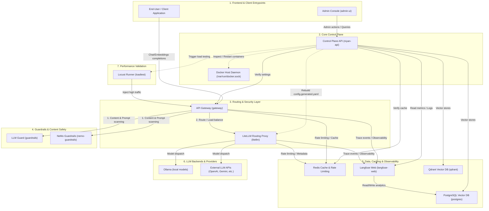

# Niyan Ecosystem Dependencies & Architecture

This document provides a comprehensive dependency graph and service-by-service breakdown of the Niyan AI Infrastructure platform. It maps out how the microservices in the `deploy/docker-compose.yml` and `/services` directories interact, including ports, purposes, and communication flows.

---

## Architectural Dependency Graph

This diagram shows the complete dependency flow. Solid lines (`-->`) represent direct runtime HTTP/gRPC/TCP dependency calls, while dashed lines (`-.->`) represent administration, configuration, or testing actions.

---

## Detailed Service Catalog & Matrix

| Service Name | Source Path | Ports (Internal / External) | Key Purpose / Functionality | Direct Dependencies |
| :--- | :--- | :--- | :--- | :--- |
| **admin-ui** | `/admin-ui` | `80` / `3080` | Single Page Application (Vite + React/Vue) providing the Admin dashboard for managing keys, configs, and viewing metrics. | `niyan-api` |
| **niyan-api** | `/api` | `8100` / `8100` | The orchestration control plane. It interacts with the Docker daemon to monitor health, manages model configurations, connects to vector stores, and triggers load tests. | `gateway`, `redis`, `loadtest`, `postgres`, `qdrant`, `langfuse-web`, Docker Daemon |
| **gateway** | `/services/gateway` | `4000` / `4000` | Entrypoint for client LLM traffic. Manages API keys, applies enterprise safety policies, routes requests to guardrails, and proxies traffic to LiteLLM. | `litellm`, `redis`, `guardrails`, `nemo-guardrails`, `langfuse-web` |
| **litellm** | `/services/litellm` (Config) | `4001` / None | Standardized OpenAI-compatible routing and load balancing proxy. Translates requests to Ollama or external LLM providers. | `redis`, `langfuse-web`, `ollama` |
| **guardrails** | `/services/llm-guard` | `8088` / None | Python service running `llm-guard` to scan prompts/responses for injection, PII leak, toxicity, and general safety. | None |
| **nemo-guardrails** | `/services/nemo` | `8089` / None | NeMo Guardrails engine for conversational guardrails and dialog guidance. | None |
| **loadtest** | `/services/loadtest` | `5000` / None | locust-based loader. Spawns headless worker tasks on-demand via the Control Plane to execute throughput & latency stress tests against the gateway. | `gateway` |
| **langfuse-web** | `/services/langfuse` (Config) | `3000` / `3100` | Analytics and LLM engineering dashboard. Tracks trace history, prompt management, and metrics. | `postgres` |
| **postgres** | Docker Hub | `5432` / None | Relational DB used by Langfuse to store traces and pgvector for native PostgreSQL vector storage. | None |
| **redis** | Docker Hub | `6379` / None | High-performance memory cache for API Gateway and LiteLLM rate-limiting and metadata caching. | None |
| **qdrant** | Docker Hub | `6333` / `6333` | Vector database for storing and querying text embeddings. | None |
| **ollama** | Docker Hub | `11434` / `11434` | Locally deployed LLM provider running models such as llama3, mistral, or nomic-embed-text. | None |

---

## Direct vs. Runtime Call Lifecycle

### 1. Control Plane & Configuration Flow
1. **Admin** saves a configuration change (e.g., adding an API Key or LLM Provider) in **admin-ui**.
2. **niyan-api** processes the change, writes/regenerates `/services/litellm/config.generated.yaml`.
3. **niyan-api** commands **Docker Daemon** via `/var/run/docker.sock` to restart/reload the `litellm` container to apply the changes.

### 2. LLM Completion Flow (Runtime)
1. **ClientApp** makes a request to `http://127.0.0.1:4000/v1/chat/completions`.
2. **gateway** checks API keys against **Redis** cache.
3. **gateway** invokes **guardrails** / **nemo-guardrails** to scan the incoming prompt.
4. If valid, **gateway** forwards the request to **litellm**.
5. **litellm** resolves the routing, fetches appropriate API credentials, and invokes either **ollama** (local) or **External APIs** (Gemini/OpenAI).
6. **litellm** and **gateway** report trace telemetry back to **langfuse-web** asynchronously.
7. The response is returned to the client.
